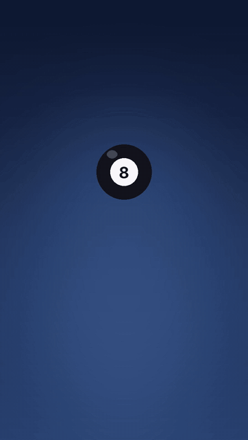
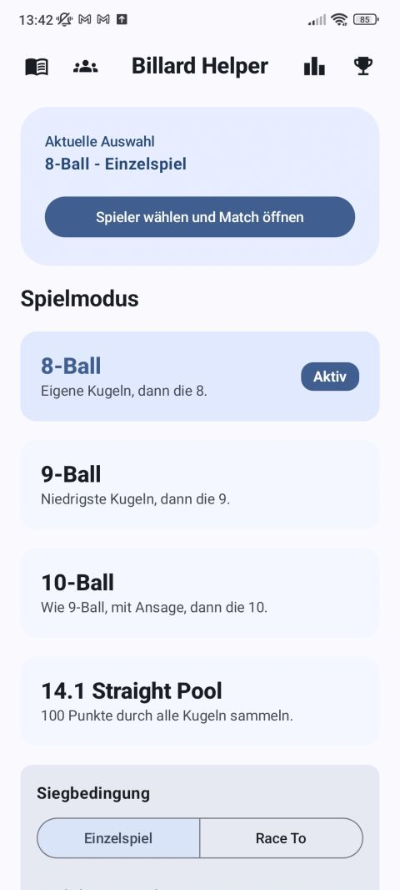
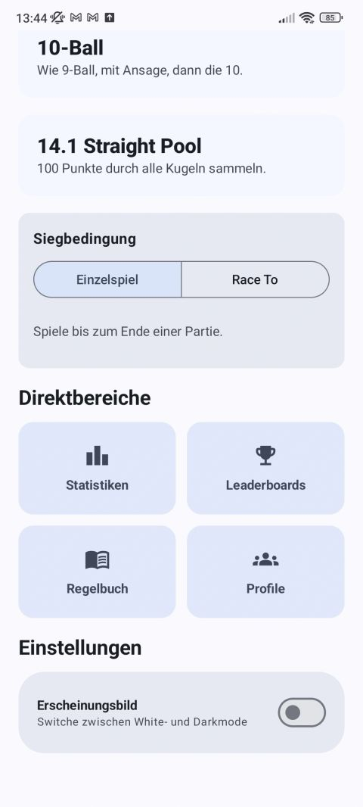
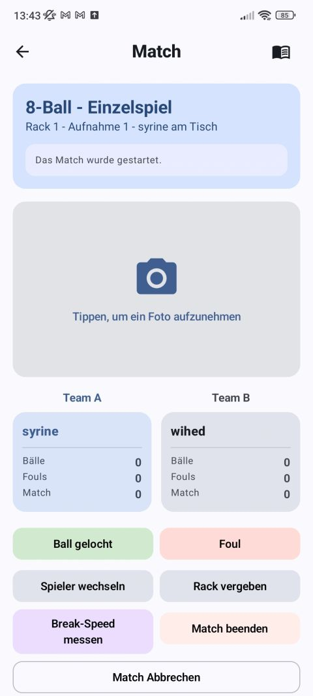
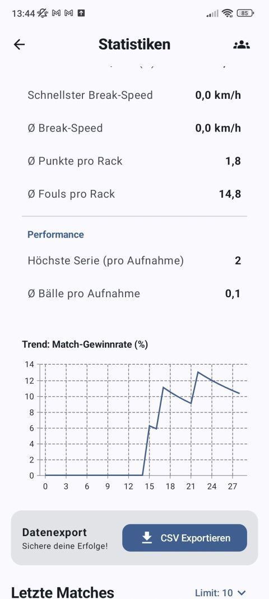
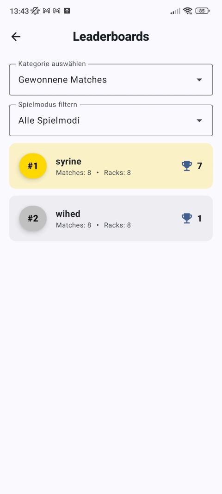
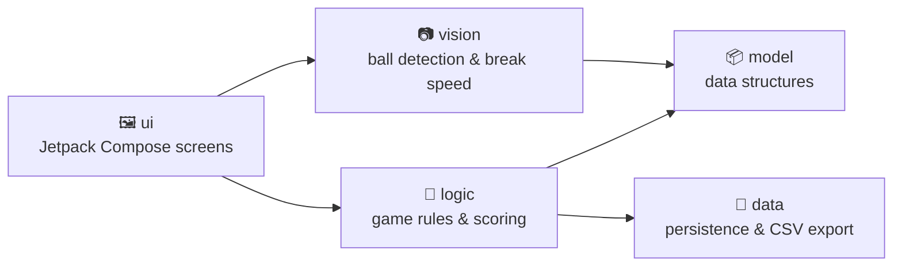
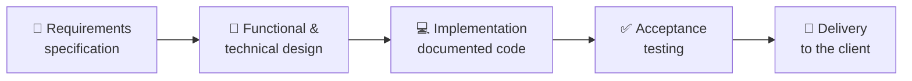

<h1 align="center">🎱 Billiard Helper</h1>

  <b>Android app for billiard players: match tracking, ball detection and statistics</b> 
  Software Engineering Project · TU Braunschweig · 2026

  
  
  
  

  

Walkthrough made from screenshots of the app · <a href="demo/demo.mp4">watch as video</a>

> [!NOTE]
> **This is a showcase repository.** Billiard Helper was built by a student team, so the source code lives in a **private repository**.
> Here you can see what the app does, how it was built and what my part was. Access to the code is available on request.

---

## 💡 About the project

Billiard Helper was developed **from scratch for a real client** as part of the Software Engineering Project at TU Braunschweig.
Players choose a game mode, track every shot of a match, let the camera capture the table, measure their break speed and follow their progress over time.
The app was delivered to the client and presented at the university's software engineering showcase (**TdSE**).

The app's interface is in German.

---

## ✨ Features

| | Feature | Description |
|---|---|---|
| 🎱 | **Four game modes** | 8-Ball, 9-Ball, 10-Ball and 14.1 Straight Pool |
| 🏁 | **Win conditions** | Single game or *Race To* a set number of racks |
| 🎯 | **Match tracking** | Pocketed balls, fouls, racks and innings, in single or team mode |
| 📷 | **Camera & ball detection** | Take a photo of the table, and the balls are detected with OpenCV |
| ⚡ | **Break speed** | Measures how fast the break shot was, in km/h |
| 📊 | **Statistics** | Break speed, points and fouls per rack, highest run, win-rate trend chart |
| 🏆 | **Leaderboards** | Rank players by won matches and other categories, filterable by game mode |
| 👤 | **Player profiles** | Create and manage local player profiles |
| 📖 | **Rule book** | Rules for every game mode, available during a match |
| 📁 | **CSV export** | Export match data for further analysis |
| 🌙 | **Dark mode** | Switch between light and dark theme |

---

## 📱 Screenshots

<table>
  <tr>
    <td align="center" width="20%"></td>
    <td align="center" width="20%"></td>
    <td align="center" width="20%"></td>
    <td align="center" width="20%"></td>
    <td align="center" width="20%"></td>
  </tr>
  <tr>
    <td align="center"><b>Home</b> Choose the game mode</td>
    <td align="center"><b>Shortcuts</b> Win condition, menu, dark mode</td>
    <td align="center"><b>Match</b> Track balls, fouls and break speed</td>
    <td align="center"><b>Statistics</b> Performance and win-rate trend</td>
    <td align="center"><b>Leaderboards</b> Player ranking</td>
  </tr>
</table>

---

## 🏗️ Architecture

| Area | Technology |
|---|---|
| Language | Kotlin |
| UI | Jetpack Compose |
| Computer vision | OpenCV |
| Build | Gradle (Kotlin DSL) |
| CI | GitLab CI: lint checks and automatic APK builds |
| Version control | Git with feature branches and merge requests (300+ commits) |

---

## 📋 Software engineering process

We followed the **complete software engineering process**, with all the documentation a real client project needs:

| Phase | What we produced |
|---|---|
| **Requirements** | Requirements specification (*Pflichtenheft*), agreed with the client |
| **Design** | Functional design (*Fachentwurf*) and technical design (*Technischer Entwurf*) |
| **Implementation** | Fully documented source code, code reviews and merge requests |
| **Testing** | Acceptance test specification (*Abnahmetestspezifikation*) |
| **Delivery** | App handed over to the client and presented at the TdSE showcase |

---

## 👩‍💻 My contribution

I worked on both the **game logic** (`logic`) and the **computer vision** (`vision`) packages, and on the project documentation.

**💻 Development**
- 🧠 Worked on the **game logic**: the rule classes for the different billiard variants (e.g. `NineBallRules`, `TenBallRules`) and the match flow, including rack handling
- 📷 Worked on the **vision package**: the `VisionManager` and `VisionViewModel`, which connect the camera and the ball detection to the app
- 🐞 Found and fixed bugs in the **win/loss detection** (`isGameWon` / `isGameLost`) and in the **last-rack handling** (`handleRackWon`)

**🔍 Code quality**
- Did an extensive **code review** of the game-rule classes, the vision classes and the use of **Kotlin coroutines**

**📋 Documentation**
- Co-wrote the **technical design** (*Technischer Entwurf*)
- Worked on the **test specifications** and the **acceptance test specification** (*Abnahmetestspezifikation*)
- Contributed to the **requirements specification** (*Pflichtenheft*) and the **functional design** (*Fachentwurf*)
- Created the **AI usage documentation** for the project, as required by the course

**🎤 Presentation**
- Presented the app with the team at the TU Braunschweig software engineering showcase (**TdSE**)

---

## 👥 Team

Developed by a team of Computer Science students at **TU Braunschweig** as part of the Software Engineering Project 2026.

Questions about the project? Reach me on <a href="https://www.linkedin.com/in/wihed-sakri/">LinkedIn</a>.

